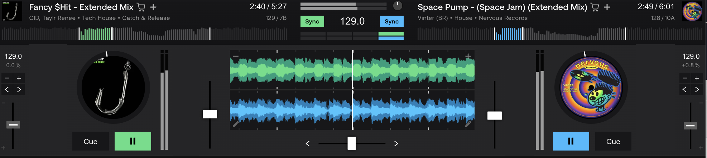

For the TUI:

- Use lazygit as a shining example of how to do a good TUI.

- When library view and/or pane is active, pressing 'a' should load to deck A, 'b' to deck
  B.

## UI

I've also got a screenshot of an ideal design for the decks.
@prompts/ui-deck-layout.png -- look at that and produce a
simplified ASCII grawing of what you understood it to look
like. From that, we'll build it.

Give yourself more width here. Render volume faders for each deck and a waveform display
(can be a mock for now).
Ensure track names dont wrap, just truncate.

Drop the Crossfader, I actually don't care about that.
